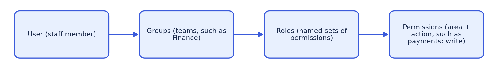

When a clerk changes departments or a new hire starts, you'll want their access to be right without setting it up person by person. In Polimorphic, people get access through groups, and groups get access through roles, which are sets of permissions. Move someone to a new group and their access follows.

Access decides who can see a resident's personal details, who can take payments, and who can change settings, so it's worth setting up carefully.

## How access fits together

*Text version of the diagram:* a user belongs to one or more groups. Each group has one or more roles. Each role is a list of permissions. A user's access is everything their groups' roles allow, combined.

### Users, groups, and roles

- **Users** are staff members.
- **Groups** are teams, such as *Finance* or *Code Enforcement*. A user can be in several groups.
- **Roles** are named sets of permissions, such as *Finance Admin*. You attach roles to groups, not to people.

### Permissions

A permission pairs an area of the product, such as [cases](/getting-started/glossary) or payments, with an action:

- **read**: see it.
- **write**: create or change it.
- **delete**: remove it.
- **export**: download it.

The full list is in [Roles and permissions matrix](/administration/roles-and-permissions-matrix).

### Access is per organization

If your workspace has several organizations, such as separate departments, access is checked for the organization you're working in. A person can have access in one department but not another.

A **Cross-Organization Role** is a role one organization shares with others in the same workspace. The owning organization controls its name and permissions.

### Role templates

When you create a role, you can start from a template and adjust it. Templates include *Staff*, *Finance Admin*, *Knowledge Base Manager*, *Account Provision*, *Org Management*, and *Super Admin*.

### Groups managed by SSO

If your organization uses single sign-on ([SSO](/getting-started/glossary)), your identity provider can control who is in a group. These groups show a lock icon. You can still rename them and change their roles, but you add or remove members in the identity provider.

### Permissions aren't the only reason something is missing

Polimorphic turns some features on for each organization. If a coworker sees something you don't and you have the same roles, the feature may not be on for your organization.

## Example: a town finance office

A town has a *Front Counter* group for clerks and a *Finance* group for the treasurer's staff.

- *Front Counter* has a *Staff* role. Clerks can work cases, update [contacts](/getting-started/glossary), and take payments.
- *Finance* has a *Finance Admin* role. Finance staff can also see payout batches and manage payment types, and they can read cases and contacts.

When a clerk moves to Finance, the administrator adds them to the *Finance* group. They keep their clerk access too, until they're removed from *Front Counter*.

**Tip:** When someone changes teams, remove them from their old group once they've handed off their work, so they don't keep access they no longer need.

## Related articles

- [Invite staff and manage accounts](/administration/invite-staff-and-manage-accounts)
- [Roles and permissions matrix](/administration/roles-and-permissions-matrix)
- [Set up single sign-on](/administration/set-up-single-sign-on-saml-or-microsoft-entra-id)
