If you've opened the [Knowledge Base](/getting-started/glossary) lately and things look different, you're not imagining it. Links, documents, text, and domains that used to live on separate tabs are now in one Sources list, and an overview at the top shows how your AI is doing and which tools it can use. Here's a walk through each part of the page and the tasks you'll do most.

## Open the Knowledge Base

1. Log into Polimorphic and click **Knowledge Base** in the left-hand menu.
2. If you manage more than one organization, use the organization selector in the top-right corner of the page to switch between them.

The page has three main areas: **Health check**, **Connected tools**, and **Sources**.

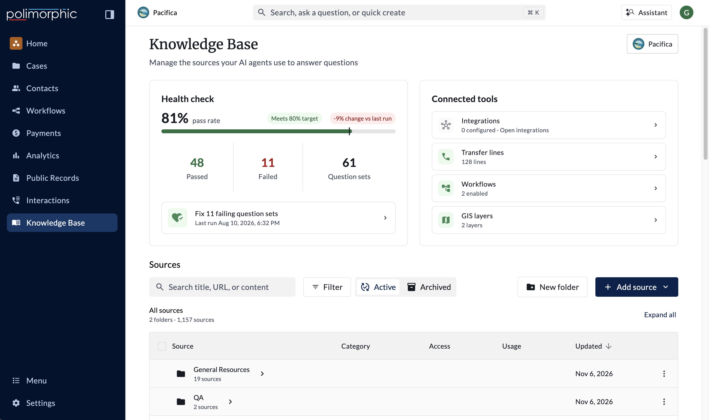

## Health check

The Health check card summarizes the most recent run of your question sets, so you can see at a glance how well your AI is answering. Health check now lives inside the Knowledge Base instead of having its own item in the left-hand menu.

- **Pass rate** shows the share of question sets that passed, with a bar and a chip that tells you whether it meets the target. If you've run the health check more than once, a second chip shows how much the pass rate changed since the previous run.
- **Passed**, **Failed**, and **Question sets** show the counts behind that pass rate.
- If any question sets failed, click **Fix failing question sets** (it shows how many failed) to go straight to them. Otherwise, click **View the latest health check** to review individual results.
- If you haven't run a health check yet, click **Configure health check** to set up your first question sets.

### Fix an answer from the health check

When you review results, a question your AI answered poorly shows an **Add source** button. Click it to add a Text source with the question and expected answer already filled in. Review the content, choose who can see it, and save. The next time someone asks that question, your AI will use your answer.

## Connected tools

Beyond written sources, your AI can use other tools to help residents. The Connected tools card lists each one with a quick count:

- **Integrations**: connected systems your AI can look information up in.
- **Transfer lines**: the phone numbers your AI can send callers to.
- **Workflows**: published workflows your AI can point residents to.
- **GIS layers**: map data your AI can use to answer location questions.

Click any tool to preview what's connected. To add or change items, click the button at the bottom of the preview:

- **Open integrations**, **Open transfer lines**, and **Open GIS layers** take you to that page in **Settings**.
- **View workflows** opens the **Workflows** page, filtered to the workflows your AI can use.

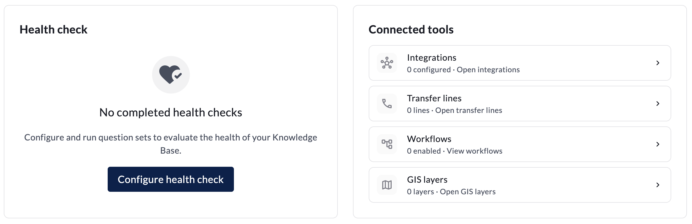

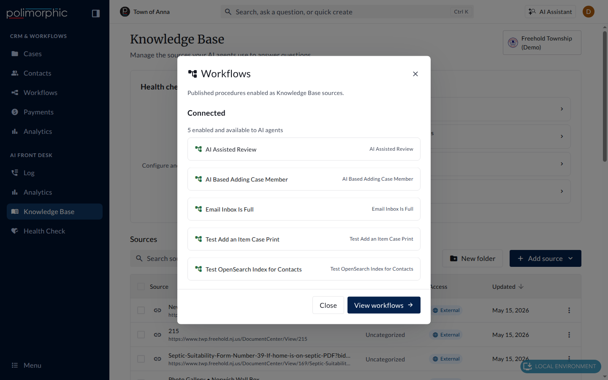

## Sources

The Sources list contains everything your AI reads to answer questions, all in one place. Each row shows:

- **Source**: the name and type (Link, Document, Text, or Domain).
- **Category**: the kind of page, such as Department, Calendar Event, or Job Posting. Text and domains don't have a category.
- **Access**: **External** sources can be used to answer residents. **Internal** sources are for staff only.
- **Usage**: how often your AI has cited or referenced the source in conversations over the last 30 days, compared with your other sources: High, Above average, Average, Low, or Unused. Hover over it to see the number of conversations, a daily chart, and when it was last used. Click the column header to sort by usage.
- **Updated**: when the source was last refreshed.

Usage is a quick way to find the sources doing the most work, and the ones your AI never uses.

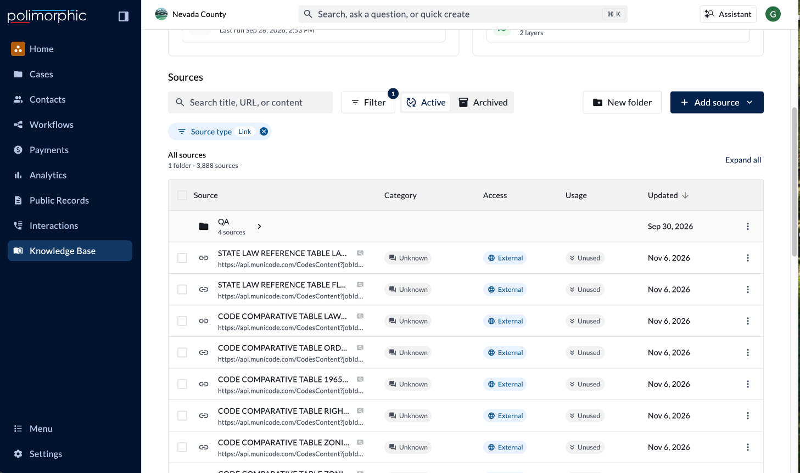

### Find a source

1. Type in **Search title, URL, or content** to look for a source by its name, web address, or the text inside it.
2. Click **Filter** to narrow the list by **URL**, **Source type**, **Access**, **Category**, **Folder**, or **Domain**. Your active filters appear as chips below the search bar, and you can remove them one at a time or all at once.
3. Use the **Active** / **Archived** toggle to switch between sources your AI is using and sources you've set aside.

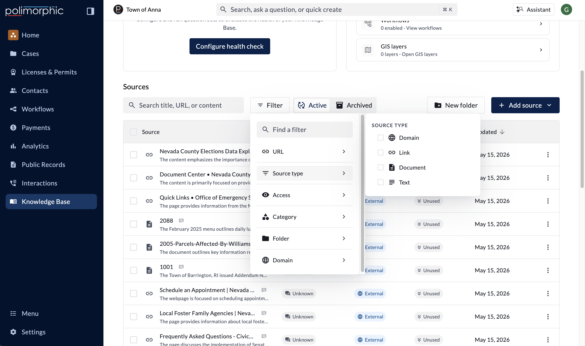

### Add a source

1. Click **Add source** in the top-right corner of the Sources list.
2. Choose the kind of source you want to add:
   - **Link**: one or more web pages. Each link must start with http:// or https://.
   - **Document**: a file such as a PDF, Word document, PowerPoint, text file, or image.
   - **Text**: a topic and its content, typed directly into Polimorphic. Use this for information that isn't published anywhere else. When Text conflicts with a link or document, your AI uses the Text. To add several in a row, click **Save and add another**. (This was called FAQs in the previous design.)
   - **Text CSV upload**: add many Text sources at once from a spreadsheet saved as a CSV. The file needs either Topic and Content columns, or Question and Answer columns.
3. Choose who can see the source (**Everyone** or **Staff only**), then save.

If you're inside a folder when you add a source, the new source is added to that folder.

<Info>
**FAQs are now called "Text"**

What used to be called an **FAQ** source is now labeled **Text** throughout the Knowledge Base. Nothing about how these sources work has changed; this is a rename only. Your existing FAQs are still there. They just appear as "Text" in the list, filters, and dialogs.

A few things to know:

- **Same structure, new labels.** Each Text source is still a topic/content pair (previously question/answer). You can add them one at a time with **Add source** > **Text**, or in bulk with **Text CSV upload**. The CSV accepts either Topic and Content or Question and Answer column headers.
- **Text takes priority.** When a Text source conflicts with a link or document, your AI uses the Text. This makes Text the right place for authoritative answers, policy clarifications, or corrections to what's on your website.
- **Availability still applies.** Like other sources, Text can be set to **Everyone** (answers residents on chat, voice, and search) or **Staff only** (internal tools only).
- **Text can be filed in folders** alongside links and documents, and can be edited or deleted from the row actions menu (**Edit Text** or **Delete Text**).
</Info>

To add pages from a whole website, contact your Customer Success Manager or email support@polimorphic.com and the team will add the domain for you.

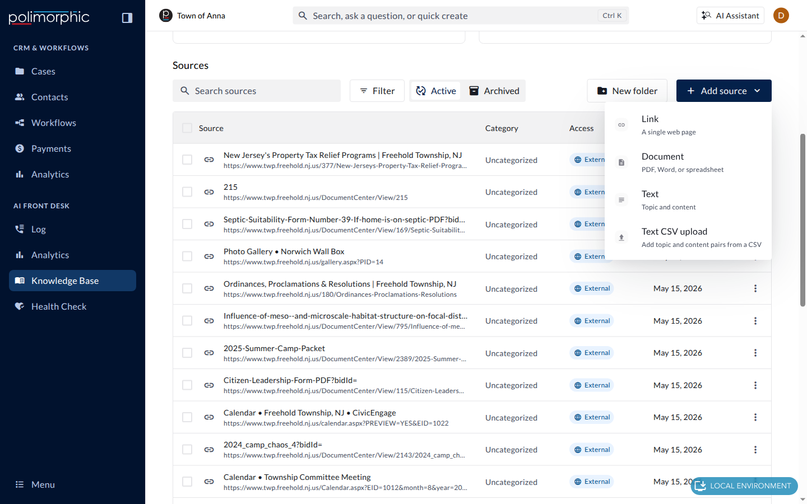

### Browse a domain

A domain is a website your AI reads page by page. Each domain row shows how many links it includes.

- Click a domain to see only its links. Click **All sources** in the breadcrumb to go back.
- For many websites you can switch between **Table view** and **Sitemap view** to see the domain's pages laid out the way the site is organized.
- Use the three-dot menu on a domain row and choose **View history** to see when the website was last read.

Domains can't be put in folders.

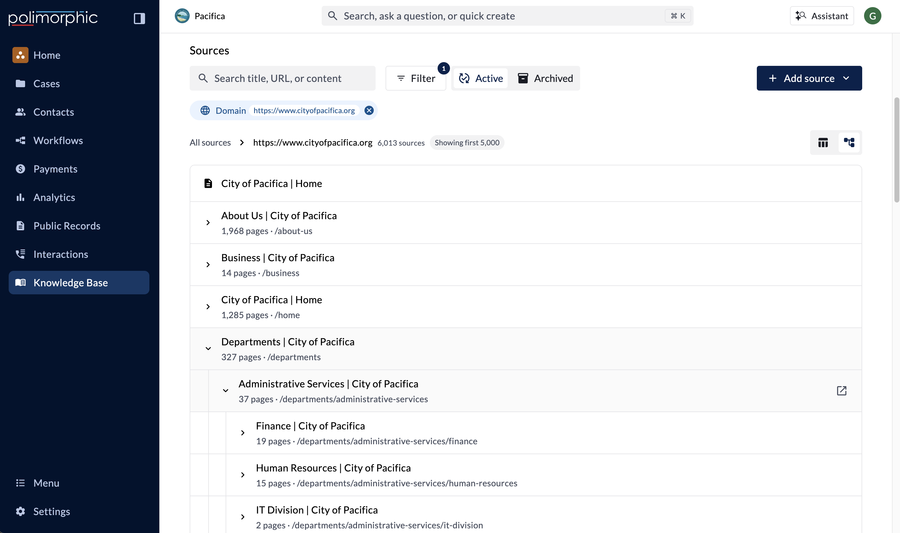

### Organize sources into folders

Folders keep related sources together, for example everything for one department or program. Links, documents, and Text can all go in folders.

1. Click **New folder** and give the folder a name.
2. Use **Expand all** to see the sources inside every folder without leaving the list, and **Collapse all** to fold them back up.

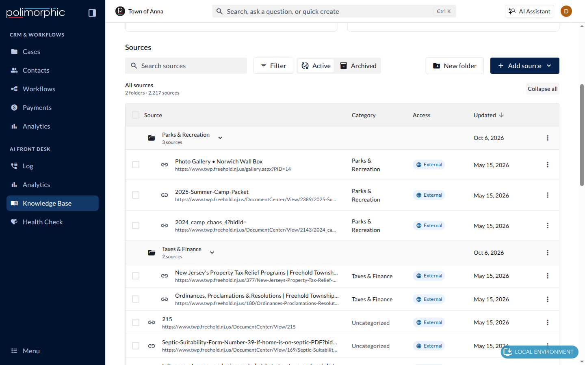

- Click a folder's name to open it. Only that folder's sources are shown, and a Folder filter chip appears above the list. Click **All sources** in the breadcrumb, or remove the chip, to go back.
- To put existing sources into a folder, select them and click **Move selected**, or open **Edit source** and choose a folder.
- To rename or delete a folder, use the three-dot menu on the folder's row. Deleting a folder doesn't delete its sources; they just stop being in that folder.

Folders can't be placed inside other folders.

<Info>
**What folders are, and aren't**

Folders are a manual organization tool only. They help you group and filter sources in the Knowledge Base list, but they don't change how your AI uses those sources. A source in a folder is searched exactly the same as an unfiled one.

A few things to know:

- **There are no automatic folder rules.** New sources aren't pulled into folders based on their URL, domain, content, or any other criteria. Unless you choose a folder when adding them, new sources land in the main list as unfiled.
- **Adding while inside a folder files the new sources there.** If you open a folder and use **Add source** (links, uploaded documents, and so on), the new sources are placed directly into that folder. This is the only "automatic" filing that happens. It applies at the moment you add the source, not to anything discovered later.
- **Re-scraping or re-crawling doesn't move sources.** Refreshing a source keeps it in whatever folder it's already in; it won't be unfiled or re-filed on its own.
- **Folders don't nest**, and deleting a folder never deletes its sources. They just become unfiled again.

Common use cases: grouping sources by department or topic (for example, "Permits" or "Meeting minutes") so your team can find and review them faster, staging a set of sources you plan to edit or archive together, or separating uploaded documents from crawled web pages.
</Info>

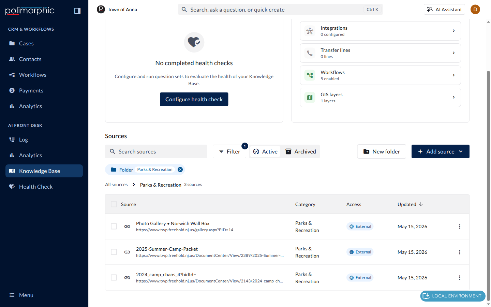

### Edit a source

1. Click the three-dot menu at the end of a row.
2. Choose **Edit source** (or **Edit Text** for a Text source).
3. From here you can:
   - Change the **Display Name**.
   - Move the source to a different **Folder**, or choose **No folder**.
   - Set **Availability** to **Everyone** or **Staff only**.
   - For sources available to Everyone, turn on **Refer to source in response** to let your AI link to the source in its answers. When it's off, your AI still uses the source but won't link to it.
   - Add tags to help your AI prioritize the source. Press Enter after each tag.
4. Click **Save**.

For links and documents, the same menu also has **Archive source** and **Manual update**. Use Manual update when a web page or document has changed and you want your AI to re-read it right away. For Text, the menu has **Delete Text**.

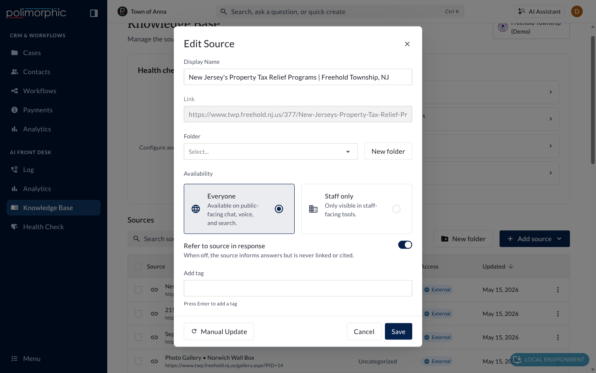

### Archive, restore, delete, or move several sources at once

1. Select the checkbox next to each source you want to change, or use the checkbox in the header to select the whole page.
2. Choose an action from the bar above the list:
   - **Move selected** puts links, documents, and Text in a folder.
   - **Archive selected** stops your AI from using the selected links and documents. Text isn't archived; if your selection includes Text, it's skipped.
   - **Delete selected** permanently deletes the selected Text sources. Links and documents are never deleted this way.
3. To bring archived sources back, switch to **Archived**, select them, and click **Restore selected**.

Archived sources stay in your Knowledge Base and can be restored at any time. Deleted Text can't be restored.

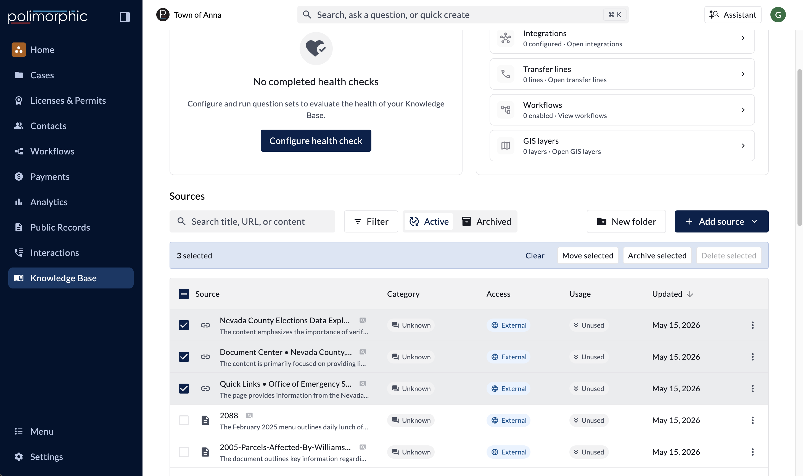

## What's changed from the previous Knowledge Base

- The separate Links, Domains, Documents, and FAQs tabs are combined into one Sources list. Use the Source type filter to see one kind at a time.
- FAQs are now called Text, and Text can now go in folders.
- Integrations, transfer lines, workflows, and GIS layers are now under Connected tools.
- Health check results appear right on the Knowledge Base page, and Health check no longer has its own item in the left-hand menu.
- A new Usage column shows which sources your AI relies on most.

## Who can see what

Anyone with access to the Knowledge Base can browse and search sources and see the Health check card. The Connected tools card, and the options to add, edit, organize, or archive sources, only show for staff who can edit the Knowledge Base. Deleting Text also requires permission to delete. If you need that access, ask an administrator in your organization.

## Related articles

- [Knowledge base sources](/ai-front-desk/knowledge-base/knowledge-base-sources)
- [Knowledge source types](/ai-front-desk/knowledge-base/knowledge-source-types)
- [Add documents, links, and FAQs](/ai-front-desk/knowledge-base/add-documents-links-and-faqs)
- [Crawl your website and set a refresh cadence](/ai-front-desk/knowledge-base/crawl-your-website-and-set-a-refresh-cadence)
- [Add GIS layers for location-based answers](/ai-front-desk/knowledge-base/add-gis-layers-for-location-based-answers)
