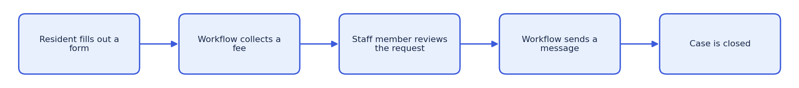

If every permit request gets handled a little differently depending on who picks it up, things slip. A [workflow](/getting-started/glossary) fixes that. It's the set of steps a request moves through, from the resident's first form to the moment staff close the [case](/getting-started/glossary).

Build it once and every request of that kind follows the same path. Residents see the same form, staff get the same tasks in the same order, and fees are calculated the same way every time. Your service stays fair and predictable, and fewer requests fall through the cracks.

## How a workflow fits together

The diagram shows one common path: a resident fills out a form, the workflow collects a fee, a staff member reviews the request, the workflow sends a message, and the case closes.

### Workflows and cases

A workflow is the template. A case is one request moving through that template. If 40 residents apply, you have one workflow and 40 cases. Each case keeps its own answers, payments, notes, and documents.

### Steps

A step is one piece of work. You add steps in the **Workflow Editor** from the **Add Steps** list. Common steps are:

- **Complete Form**: someone answers questions. It can be a resident or a staff member.
- **Collect Payment**: the workflow creates a bill.
- **Send Message**: the workflow sends an email or text.
- **Change Case Status**, **Add Tag**, and **Assign Case Role**: the workflow updates the case for you.

See [Workflow block types](/building-workflows/workflow-block-types) for the full list.

### Who does each step

Each step says who can complete it. **Public facing (external)** means the resident completes it. **Staff only (internal)** means your team does. You can add [assignees](/getting-started/glossary) to a step so the right people get notified when the step opens.

### Connections and conditions

Arrows connect the steps and set their order. A step opens when the steps before it are done. If a step has more than one arrow coming into it, it can wait for all of them or start after any one of them. You can also add conditions, so a step runs only when an answer matches a rule. For example, a fee step can run only when the applicant is a business.

### Stages

Stages group steps into phases, such as "Application," "Review," and "Decision." Stages help residents and staff see how far along a case is.

### Draft, live, and archived

- **Draft**: you can edit anything and create test cases. Residents can't apply.
- **Live**: the workflow is published. Residents and staff can start real cases. Editing is limited so active cases aren't disrupted.
- **Archived**: the workflow no longer takes new cases. Past cases stay available.

## Example: a sidewalk dining renewal

The Town of Fairview renews sidewalk dining approvals each spring. The clerk builds one workflow with four steps:

1. A public form where the restaurant owner confirms the business name, address, and seating layout, and uploads an insurance certificate.
2. A payment step that bills the $150 renewal fee.
3. A staff-only review step assigned to the clerk's office.
4. A message step that emails the approval and closes the case.

Each spring, every restaurant applies through the same form. The clerk sees each renewal as a case with the payment already attached.

## Related articles

- [Create a workflow: build a permit renewal from start to finish](/building-workflows/create-a-workflow-build-a-permit-renewal-from-start-to-finish)
- [Build a form with conditional fields](/building-workflows/build-a-form-with-conditional-fields)
