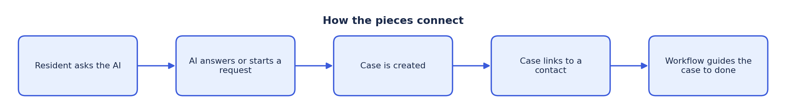

Residents reach your organization in many ways: your website, phone, email, or a visit to the counter. Without one system, the same question gets answered over and over, and requests get lost between inboxes and spreadsheets.

Polimorphic brings all of that into one place, so you can answer residents, track their requests, and move each one through your department's steps until it's done. Four ideas come up every day: AI answers, [cases](/getting-started/glossary), [contacts](/getting-started/glossary), and [workflows](/getting-started/glossary). Once you know how they connect, you'll always know where to look for a request and what happens next.

## How a request moves through Polimorphic

Most requests follow the same path:

1. **A resident asks a question.** The [AI Front Desk](/getting-started/glossary) answers on your website chat, site search, or phone line. It uses the [knowledge base](/getting-started/glossary) your team sets up, such as your web pages, documents, and [FAQs](/getting-started/glossary) (frequently asked questions).
2. **The AI answers or starts a request.** Plenty of questions end here, like "When is bulk trash pickup?" When the resident needs something done, such as applying or paying, they start a request.
3. **A case is created.** A case is the record of one request. It holds the resident's answers, files, payments, emails, staff notes, and a history of everything that happened. Staff can also open a case themselves, such as after a phone call.
4. **The case links to a contact.** A contact is the record for a person or organization. Polimorphic connects each case to the right contact, so you can see everything one resident has done with your organization.
5. **A workflow guides the case to done.** A workflow is the set of steps for one type of request. It decides which forms the resident fills out, who on staff reviews the case, when to take a payment, and which emails go out. Your administrators build workflows once, and every case of that type follows them.

### Where to find each piece

- **Cases** in the left sidebar lists every case you can see.
- **Contacts** in the left sidebar lists people and organizations.
- **Workflows** in the left sidebar is where administrators build and publish workflows.
- The AI Front Desk tools, such as **Knowledge Base** and **Log**, are in the lower part of the left sidebar.

## Example: a permit renewal

Maria Lopez wants to renew her building permit. She opens your city's website and asks the chat, "How do I renew my building permit?" The AI explains the renewal rules from your knowledge base and links to the renewal application. Maria fills out the form and uploads her inspection report. That creates a case. Polimorphic matches her email to her existing contact record, so staff can see her earlier permit too. The permit renewal workflow assigns the case to a permit technician, who reviews the report, takes the renewal fee, and closes the case. Maria gets an email at each step.

## Related articles

- [Quickstart: your first day](/getting-started/quickstart-your-first-day)
- [What is a case?](/working-in-polimorphic/cases/what-is-a-case)
- [How contacts and interaction history work](/working-in-polimorphic/contacts/how-contacts-and-interaction-history-work)
- [Glossary](/getting-started/glossary)
