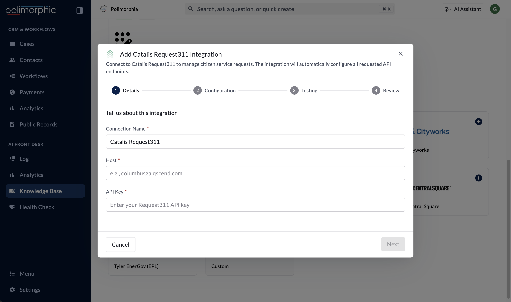

If residents already file service requests through Catalis Request311, connecting it means the AI can help them do it from chat or the phone. Polimorphic can find service-request types, provide request guidance, create service requests, retrieve existing requests, and use related knowledge articles.

## Video walkthrough

<iframe src="//www.loom.com/embed/352303b1f8e94467b76676edee67ec17" width="100%" height="420" style={{border: 0, borderRadius: 12}} allowFullScreen />

## Before you begin

Have these ready:

- The organization's Request311 API host
- A Request311 API key
- The resident fields staff want Polimorphic to collect before creating a request

## Vendor provisioning guidance

The organization's integration owner should lead the request as the authorized Catalis customer contact. Start with the organization's Catalis support or account representative and ask for:

- API access and an API key for the organization's Request311 or QAlert tenant
  - Visit this page: &lt;https://developers.qscend.com/>
- Confirmation of the QScend host
- A sandbox or test site and a read-only test login, when available
- Network allowlisting instructions
- Request-type, category, and form-field documentation needed for configuration

Catalis may direct the organization to complete a developer or integration application. Keep the customer owner included until the key, host, and network access have been confirmed. API access may be subject to the organization's vendor licensing or additional fees.

Share the API key through an approved secure method, not through ordinary email, chat, tickets, screenshots, or recordings.

Only one Catalis Request311 connection can be added to a Polimorphic organization.

## Setup fields

| Field | Requirement | Guidance |
| --- | --- | --- |
| Connection Name | Required | Defaults to **Catalis Request311**. |
| Host | Required | Enter a hostname such as `columbusga.qscend.com`. Don't include `https://`, a path, or a trailing slash. |
| API Key | Required | Use the API key supplied for the organization. |

Polimorphic sends the key as an API query credential and stores the secret value in protected credential storage.

## Pick what residents need to provide

On **Configuration**, pick the fields the agent must collect before creating a service request.

The default required fields are:

- First Name
- Email

You can also require:

- Last Name
- Phone
- Address
- Address Line 2
- City
- State
- ZIP Code
- Middle Initial

Pick fields your organization can reliably use to support residents and validate follow-up requests. Don't require information you don't need.

## What the integration can do

Polimorphic configures:

- **Get Types:** Find matching request types.
- **Create Case:** Create a Request311 service request.
- **Get Case:** Retrieve an existing request by case ID.
- **Get Prompt:** Retrieve the public questions or instructions for a request type.
- **Get Knowledge Articles:** Retrieve articles related to request types.

Create Case needs a request type and city, plus the required submitter fields selected during setup. Get Case asks for identity information before returning a resident's request data. Validate both a successful match and a mismatch before resident-facing use.

## What the setup test checks

The setup test:

1. Calls **Get Types**.
2. If a request type is returned, checks **Get Prompt** and **Get Knowledge Articles** with that type.
3. Leaves **Create Case** untested because it creates a provider record.
4. Leaves **Get Case** untested because it requires a real case ID and identity information.

An untested result is expected for the last two capabilities. Don't create a real service request just to complete the setup screen.

## Finish setup and test it

Follow [Set up a hosted integration](/integrations/set-up-a-hosted-integration) to complete the Details, Configuration, and Testing steps.

After creation:

1. Open the connected integration's **Configure** dialog.
2. Review access for Chat, Voice, Search, Assistant, and Workflows.
3. Test request-type lookup with a common service question.
4. In an approved sandbox, test case creation.

Once those tests pass, the integration is ready for residents and staff to use on the surfaces you turned on.
