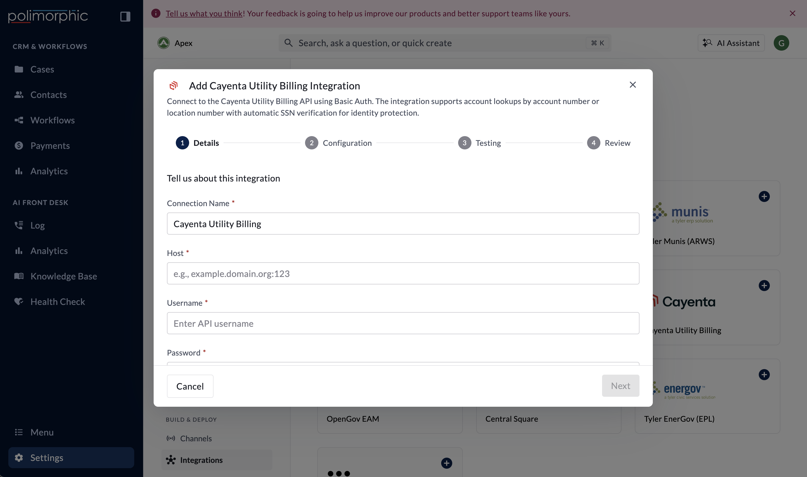

Residents call with the same utility questions every month: where's my service location, what's my balance. Connecting Cayenta Utility Billing lets Polimorphic search service locations and provide protected utility-account information after SSN verification.

## Video walkthrough

<iframe src="//www.loom.com/embed/e7c6f30547954b6f93f5d36bf7fa12f0" width="100%" height="420" style={{border: 0, borderRadius: 12}} allowFullScreen />

## Before you begin

Have these ready:

- The Cayenta API server hostname and port
- A Cayenta API service username and password
- Confirmation that the service account can use the required operations
- Approved test accounts with SSN data for identity-verification testing

## Vendor provisioning guidance

You can file a ticket for API access: &lt;https://tickets.cayenta.com/dashboard>

The organization's utility-systems administrator and IT team should own provisioning. If they cannot create the service account or locate the API details, the authorized customer contact should involve its Cayenta or Harris representative or support team. Ask for:

- Test and production service endpoints, including the required host and port
- Dedicated service accounts, with separate credentials for each environment when available
- Current API documentation
- Approved test accounts with synthetic or non-production data
- Network allowlisting requirements for the service endpoint

API access may be separate from normal user-interface access and may be subject to the organization's vendor licensing or additional fees. Confirm the account's permitted operations before enabling protected lookups.

Share the service credentials through an approved secure method, not through ordinary email, chat, tickets, screenshots, or recordings.

## Setup fields

| Field | Requirement | Guidance |
| --- | --- | --- |
| Connection Name | Required | Defaults to **Cayenta Utility Billing**. |
| Host | Required | Enter the server hostname and port, such as `example.domain.org:123`. Don't add the Cayenta service path. |
| Username | Required | Cayenta API username. |
| Password | Required | Cayenta API password. |

Polimorphic uses HTTP Basic authentication. Secret credential values are stored in protected credential storage.

## What the integration can do

The setup lists:

- **Find Locations**
- **Check Balance by Account**
- **Check Balance by Location**
- **Check Bill Due Date by Account**
- **Check Bill Due Date by Location**
- **Check Pay Arrangements by Account**
- **Check Pay Arrangements by Location**
- **Check Budget Balance by Account**
- **Check Budget Balance by Location**

Find Locations searches service locations by street information.

Every displayed account-data capability requires the last four digits of the customer's SSN. Account-number lookups also require a valid account number. Location-number lookups resolve the location to an account before returning protected information.

Don't enable protected capabilities on a surface until staff have verified:

- The surface collects the required identity information.
- A correct SSN value allows the request.
- An incorrect, missing, or incomplete value blocks the request.
- Support logs and screenshots don't contain the SSN or account details.

## What the setup test checks

The setup test calls Find Locations with safe built-in sample values.

The eight protected capabilities appear as **Untested Endpoint** because they require real account or location information and SSN verification.

An untested result is expected. Complete identity-verification testing later with approved test accounts. Review the returned Cayenta data as well as the HTTP status because provider application errors may be returned inside an HTTP success response.

## Finish setup and test it

Follow [Set up a hosted integration](/integrations/set-up-a-hosted-integration) to complete the shared flow.

After creation:

1. Review access for Chat, Voice, Search, Assistant, and Workflows.
2. Test account and location lookups with correct identity values (if required).
3. Test incorrect and missing identity values.

Once those tests pass, the integration is ready to use on the surfaces you turned on.
