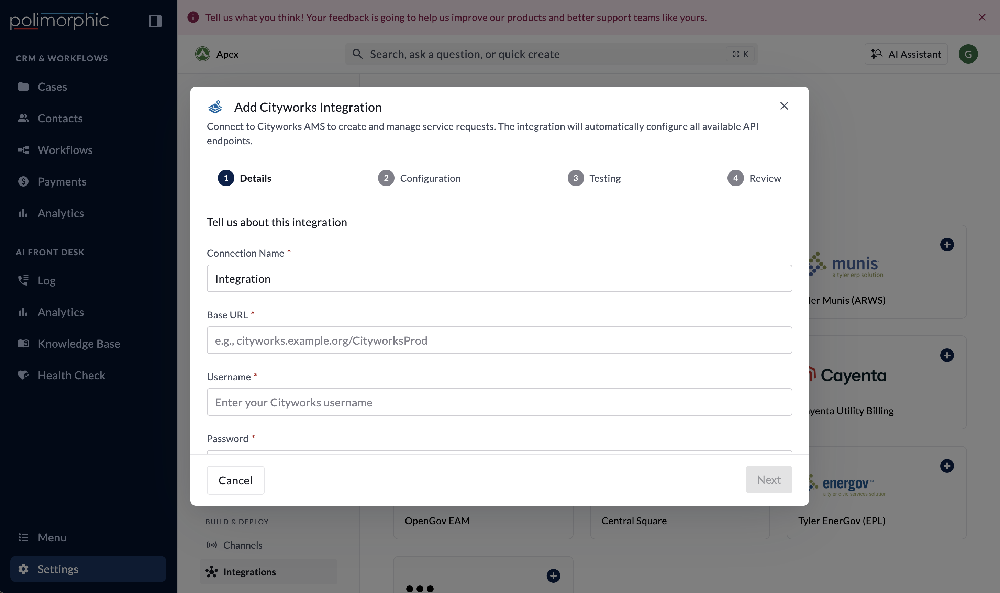

If your public works team tracks service requests in Cityworks, connecting it lets Polimorphic support Cityworks AMS service-request operations. Workflow and webhook synchronization require additional implementation configuration after the hosted connection is created.

## Video walkthrough

<iframe src="//www.loom.com/embed/d2a8d8ebe21d4e9c8a51a3c1917a7e7a" width="100%" height="420" style={{border: 0, borderRadius: 12}} allowFullScreen />

## Before you begin

Have these ready:

- The Cityworks server URL
- A Cityworks service username and password
- A safe service request for read testing
- The workflow and field-mapping requirements for the organization

## Vendor provisioning guidance

The organization's Cityworks administrator should own provisioning, with IT and the service-request program owner included. Contact Cityworks or Trimble support when the organization needs help confirming licensing, activating API access, or resolving a platform issue. Ask for:

- Production and test base URLs, when both environments are available
- Confirmation that the service-request API is enabled, plus a dedicated service user
- Group access to every service-request template in scope
- The supported API version, template IDs, problem codes, coordinate-system details, and field definitions
- Message Queue Service and Action Manager guidance when webhook synchronization is planned
- Advance notice of provider upgrades or password-policy changes that may affect the service user

API access, service-user features, or webhook components may depend on the organization's Cityworks licensing and may involve additional fees. Confirm the available features before implementation mapping begins.

Share the service credentials through an approved secure method, not through ordinary email, chat, tickets, screenshots, or recordings.

## Setup fields

| Field | Requirement | Guidance |
| --- | --- | --- |
| Connection Name | Required | Defaults to **Cityworks**. |
| Base URL | Required | Enter the host and optional Cityworks path, such as `cityworks.example.org/CityworksProd`. Don't include `https://`. |
| Username | Required | Cityworks service username. |
| Password | Required | Cityworks service password. |

Polimorphic signs in with the username and password to obtain a Cityworks session token, then uses that token for Cityworks API requests.

## What the integration can do

The hosted setup lists:

- **Create Service Request**
- **Update Service Request**
- **Get Service Request**
- **Add Comments**

Create Service Request requires a Cityworks problem type and address. Other location, description, and caller fields may be included when available.

Creating the connection doesn't by itself map a Polimorphic Workflow to Cityworks. Implementation staff must separately configure the Workflow, request-field mappings, status mappings, and any inbound webhook behavior required by the organization.

## What the setup test checks

The setup test verifies that Polimorphic can sign in to Cityworks. It doesn't create, update, retrieve, or comment on a real service request during setup.

The four displayed operations may therefore appear untested even when authentication succeeds. Use a provider sandbox or approved test request for later validation.

## Finish setup and test it

Follow [Set up a hosted integration](/integrations/set-up-a-hosted-integration) to complete the shared flow.

After creation, work with the implementation owner to:

1. Map the intended Polimorphic Workflow fields to Cityworks.
2. Confirm the required Cityworks problem type and address values.
3. Configure status mapping when status synchronization is needed.
4. Configure and protect any inbound webhook secret.
5. Test create, retrieve, update, comment, and status behavior with an approved test request.

Once those tests pass, the integration is ready to use on the surfaces you turned on.
