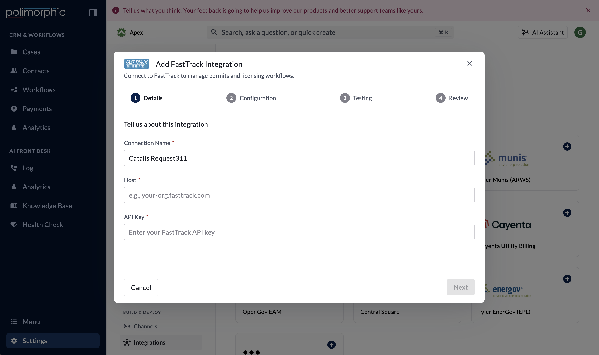

"Where's my permit?" is one of the most common questions a permit desk gets. Connecting FastTrack lets Polimorphic search permit records and retrieve permit, review, hold, inspection, and staff information.

## Video walkthrough

## Before you begin

Have these ready:

- The organization's FastTrack API host
- A FastTrack API key
- A safe permit record for end-user testing

## Vendor provisioning guidance

Assign an internal API owner who can provide:

- The production and test API hosts, when both environments are available
- A dedicated API key with only the access needed for permit lookup
- The supported API version, permit-search inputs, response fields, error behavior, and representative response examples
- Known permit numbers and addresses for safe testing
- A contact who owns API changes when the underlying permitting system is upgraded

If your FastTrack implementation depends on a third-party permitting platform, the organization's IT owner should coordinate any required vendor support. Ask the vendor to clarify API entitlement, authentication, and upgrade compatibility. API access may be subject to the organization's existing vendor terms or additional fees.

Share the API key through an approved secure method, not through ordinary email, chat, tickets, screenshots, or recordings.

## Setup fields

| Field | Requirement | Guidance |
| --- | --- | --- |
| Connection Name | Required | Defaults to **FastTrack**. |
| Host | Required | Use the accepted host format `fasttrack.your-org.net`. Enter the host without a path. |
| API Key | Required | Use the API key supplied for the organization. |

Polimorphic sends the key in the provider's API-key header and stores the secret value in protected credential storage.

## What the integration can do

Polimorphic configures:

- **Search Permits**
- **Get Permit Details**
- **Get Permit Information**
- **Get Permit Reviews**
- **Get Permit Holds**
- **Get Permit Inspections**
- **Get Staff Info**

Search Permits can use address criteria. Permit-specific capabilities use a permit number returned by search.

Get Permit Information asks for applicant name and property address before returning personalized permit information. Test both matching and mismatching values before resident-facing use.

## What the setup test checks

The setup test:

1. Runs Search Permits with a built-in sample address.
2. If the search returns a permit number, uses it to test permit details, information, reviews, holds, and inspections.
3. Marks the dependent checks untestable when the sample search doesn't return a permit.
4. Does not provide a hosted test result for Get Staff Info.

An untestable result may only mean the built-in sample address did not match the organization's data.

After setup, open **Configure** and confirm the final enabled capabilities. Then use a known safe permit and address to test each intended surface.

## Finish setup and test it

Follow [Set up a hosted integration](/integrations/set-up-a-hosted-integration) to complete the shared setup flow.

After creation:

1. Confirm capability access for Chat, Voice, Search, Assistant, and Workflows.
2. Test address search with a known permit.
3. Test the related permit capabilities with the returned permit number.
4. Test identity matching for Get Permit Information.

Once those tests pass, the integration is ready to use on the surfaces you turned on.
