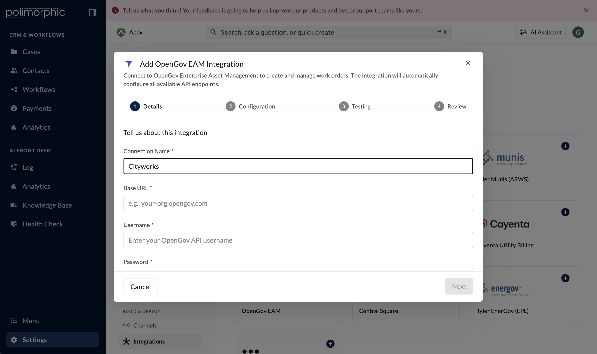

When a resident reports a broken streetlight or a pothole, it usually ends up as a work order. Connecting OpenGov EAM lets Polimorphic create, update, retrieve, and list Enterprise Asset Management work orders.

## Video walkthrough

<iframe src="//www.loom.com/embed/ed6f784c776d4996a055341f1a34bbf6" width="100%" height="420" style={{border: 0, borderRadius: 12}} allowFullScreen />

## Before you begin

Have these ready:

- The organization's OpenGov EAM host
- A dedicated OpenGov API username and password
- Confirmation that the account can read and manage the required work orders
- Safe work-order records for testing

## Vendor provisioning guidance

OpenGov developer portal: &lt;https://developer.opengov.com/>

OpenGov API documentation: &lt;https://developer.opengov.com/docs/overview>   
  
The organization's OpenGov administrator or implementation project owner should lead provisioning. Contact the organization's OpenGov account representative or support team for help confirming EAM API access. Ask for:

- Production and test EAM base URLs, when both environments are available
- A dedicated service account with the least access needed for the intended work-order operations
- The supported API version, available work-order fields, endpoint access, and current REST API documentation
- Safe work-order records and valid priority and department values for testing
- Webhook configuration guidance when completion or status events will be synchronized

API access or webhook features may depend on the organization's OpenGov contract and may involve additional fees. Confirm the available access before finalizing field mappings and Workflow behavior.

Share the service credentials through an approved secure method, not through ordinary email, chat, tickets, screenshots, or recordings.

Confirm OpenGov licensing and API access with the organization's OpenGov administrator.

## Setup fields

| Field | Requirement | Guidance |
| --- | --- | --- |
| Connection Name | Required | Defaults to **OpenGov EAM**. |
| Base URL | Required | Enter a host such as `your-org.opengov.com` without `https://`. |
| Username | Required | OpenGov API service username. |
| Password | Required | OpenGov API service password. |

Poli uses the shared username and password with HTTP Basic authentication. The secret value is stored in protected credential storage.

## What the integration can do

The setup lists:

- **Create Work Order**
- **Update Work Order**
- **Get Work Order**
- **List Work Orders**

Create Work Order requires a description and priority. Department, notes, and status are optional. Status defaults to Planned.

Update and Get Work Order require the work-order OID. Poli also configures priority and department lookups that support create and update operations. These support lookups are not selectable in the hosted setup list.

No OpenGov-specific resident identity-verification rule is added by this hosted integration. Review the intended data and audience before enabling it on a resident-facing surface.

## What the setup test checks

The setup test calls List Work Orders.

Create Work Order remains untested because it creates provider data. Get and Update Work Order remain untested because setup doesn't have a valid OID.

An untested result is expected for those operations. Use an approved sandbox and disposable work order for later create and update testing.

## Default access

Update Work Order is initially intended for Workflows. Other generated OpenGov capabilities may start with broader surface access.

After creation, open **Configure** and apply the organization's approved surface matrix. Avoid enabling write operations in resident-facing Chat or Voice unless the complete confirmation and authorization flow has been approved.

## Finish setup and test it

Follow [Set up a hosted integration](/integrations/set-up-a-hosted-integration) to complete the shared flow.

After creation:

1. Test List Work Orders.
2. Retrieve a safe work order by OID.
3. Create a work order and confirm priority and department handling.
4. Update the record and confirm the changed fields.

Once those tests pass, the integration is ready to use on the surfaces you turned on.
