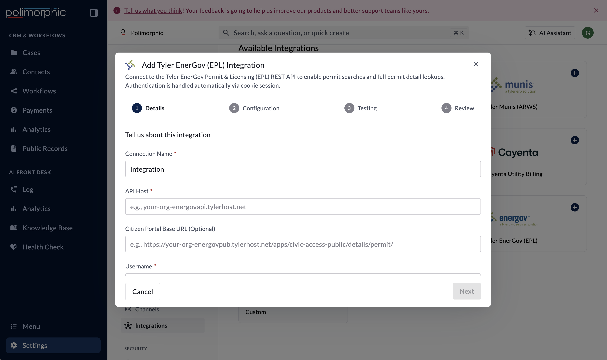

When a resident asks about their permit, staff often have to look it up in EnerGov by hand. Connecting Tyler EnerGov (EPL) lets Polimorphic look up a permit by permit number and return permit details with a public Citizen Portal link.

## Video walkthrough

<iframe src="//www.loom.com/embed/01e656f5b0d0466ea771302e2fc5f25c" width="100%" height="420" style={{border: 0, borderRadius: 12}} allowFullScreen />

## Before you begin

Have these ready:

- The EnerGov API host
- An EnerGov API username and password
- The public Citizen Portal permit URL when the organization uses a nonstandard host or path (optional)
- A safe permit number for end-user testing

## Credential provisioning guidance

The organization's project owner should lead the request with its Tyler account representative or Tyler support. Include the permitting administrator and IT owner so the vendor request covers both API access and the organization's EnerGov environment. Ask for:

- EnerGov EPL API access
- Test and production API hosts and credentials, when both environments are available
- The public Citizen Portal base URL
- The supported API version, available permit-detail fields, and current authentication documentation
- Safe permit numbers and status definitions for testing
- The vendor's standard process for any required agreement or security review

Tyler may offer EPL API access as a separately licensed package, which can affect the organization's fees. Confirm the included access and scope with the account representative before configuration. The authorized customer contact should remain the primary owner of the vendor request.

Share the service credentials through an approved secure method, not through ordinary email, chat, tickets, screenshots, or recordings.

Confirm the account can sign in to the EnerGov permit API.

## Setup fields

| Field | Requirement | Guidance |
| --- | --- | --- |
| Connection Name | Required | Defaults to **EnerGov EPL**. |
| API Host | Required | Enter a host such as `your-org-energovapi.tylerhost.net` without `https://`. |
| Citizen Portal Base URL | Optional | Enter a full URL such as `https://your-org-energovpub.tylerhost.net/apps/civic-access-public/details/permit/` when the default cannot be derived. |
| Username | Required | EnerGov API username. |
| Password | Required | EnerGov API password. |

If the Citizen Portal field is empty, Polimorphic replaces `energovapi` with `energovpub` and uses the standard civic-access permit path. Enter the full URL when the organization's public host or path is different.

Polimorphic signs in with the username and password, stores the secret values in protected credential storage, and manages the EnerGov session cookie automatically.

## What the integration can do

Polimorphic configures **Get Permit Details**.

The capability:

1. Searches for a permit number.
2. Retrieves the first matching permit's details.
3. Returns available permit status, type, work class, description, dates, valuation, balance, inspector or update information, attachment names, and a public Citizen Portal link.

Polimorphic doesn't return direct attachment, storage, signed, or download URLs through this hosted capability.

## What the setup test checks

The setup test signs in and runs a permit quick search. It doesn't retrieve a known permit's full details.

A successful setup test confirms basic reachability and sign-in behavior, not the complete permit lookup. Test later with a safe permit number and verify the public portal link.

## Finish setup and test it

Follow [Set up a hosted integration](/integrations/set-up-a-hosted-integration) to complete the shared flow.

After creation:

1. Review access for Chat, Voice, Search, Assistant, and Workflows.
2. Test a known permit number.
3. Confirm the returned details match EnerGov.
4. Open the public Citizen Portal link.

Once those tests pass, the integration is ready to use on the surfaces you turned on.
