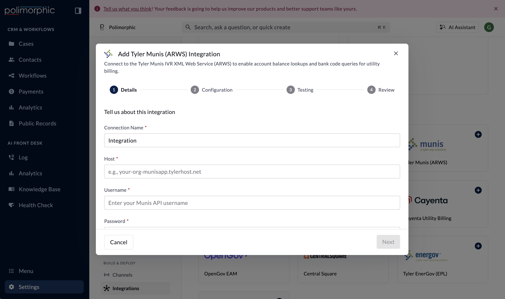

Balance questions are some of the most frequent calls a utility billing office gets. Connecting Tyler Munis (ARWS) lets Poli retrieve utility billing bank codes and account-balance information from the Munis IVR XML Web Service.

## Video walkthrough

<iframe src="//www.loom.com/embed/faef4464346d42d88ea1f544f85bae58" width="100%" height="420" style={{border: 0, borderRadius: 12}} allowFullScreen />

## Before you begin

Have these ready:

- The Munis ARWS host
- A Munis API username and password
- The utility-billing category to use by default
- A safe test account number and customer ID for end-user testing

## Vendor provisioning guidance

The organization's project owner should lead the request with its Tyler account representative or Tyler support. Include the utility-billing administrator and IT owner so the request covers both provider access and local data requirements. Ask for:

- ARWS or IVR web-service access for utility-billing lookup
- The correct Munis host and endpoint information
- A dedicated service username and password
- The correct utility-billing category code (optional; default of **60** will be used)
- A test environment or approved test accounts with representative billing data

Tyler may treat ARWS, IVR, or API access as a separately licensed service, which can affect the organization's fees. Confirm the included access and scope with the account representative before configuration. The authorized customer contact should remain the primary owner of the vendor request.

Share the service credentials through an approved secure method, not through ordinary email, chat, tickets, screenshots, or recordings.

Confirm with the Munis administrator that ARWS access is enabled for the account. Only one Munis ARWS connection can be added to a Polimorphic organization.

## Setup fields

| Field | Requirement | Guidance |
| --- | --- | --- |
| Connection Name | Required | Defaults to **Munis ARWS**. |
| Host | Required | Enter a host such as `your-org-munisapp.tylerhost.net`. Use the hostname without `https://` or a path. |
| Username | Required | Munis ARWS service username. |
| Password | Required | Munis ARWS service password. |
| Default Category | Optional | Defaults to `60`. Confirm the correct category with the utility-billing team. |

Polimorphic sends the username and password inside an HTTPS SOAP request. The secret credential values are stored in protected credential storage.

## What the integration can do

Polimorphic configures:

- **Get Bank Codes:** Return available bank or payment codes.
- **Get Account Balance:** Return utility-account billing information.

Get Account Balance needs an account number and customer ID. It can return total due, current and past-due amounts, bill records, due dates, last-payment information, and cut-off information when provided by Munis.

This integration retrieves billing information. It doesn't submit a payment.

The connector doesn't add a separate Polimorphic resident identity-verification step. Confirm that the organization's use case and enabled surfaces collect the account information required by its privacy policy.

## What the setup test checks

The setup test calls Get Bank Codes.

Get Account Balance appears as **Untested Endpoint** because setup doesn't collect a real account number and customer ID. Test that capability later with an approved test account.

The setup check confirms an HTTP response but may not identify every Munis SOAP-level error. If the setup test passes but the end-user call fails, review the returned Munis error and category.

## Finish setup and test it

Follow [Set up a hosted integration](/integrations/set-up-a-hosted-integration) to complete the shared flow.

After creation:

1. Review access for Chat, Voice, Search, Assistant, and Workflows.
2. Test Get Bank Codes.
3. Test Get Account Balance with a safe account and the default category.
4. Test an account with no bills in that category.
5. Confirm account and customer identifiers are never shown in screenshots or support messages.

Once those tests pass, the integration is ready to use on the surfaces you turned on.
