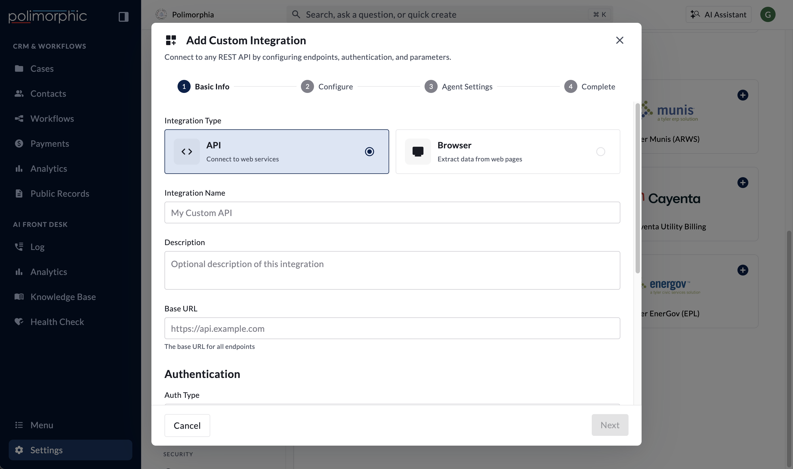
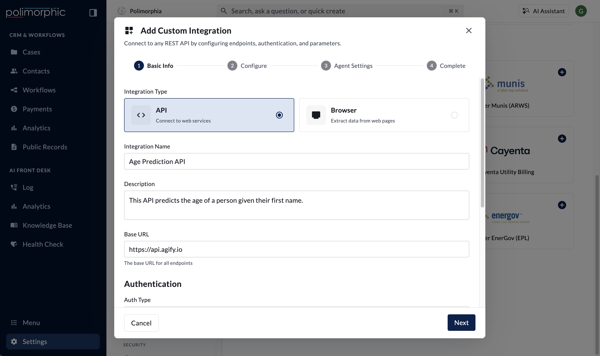
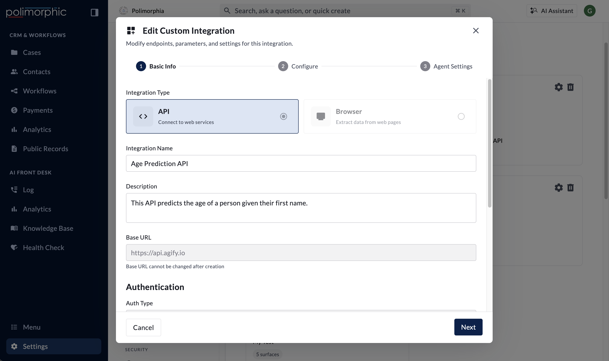
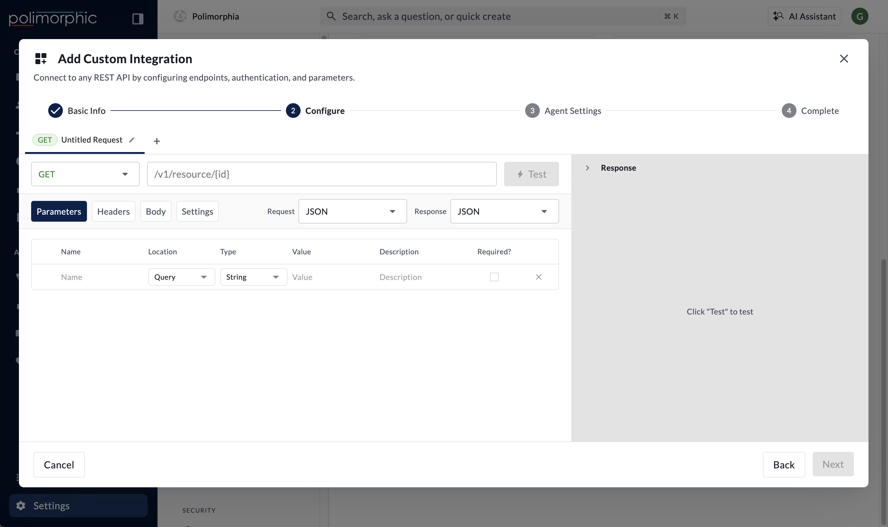
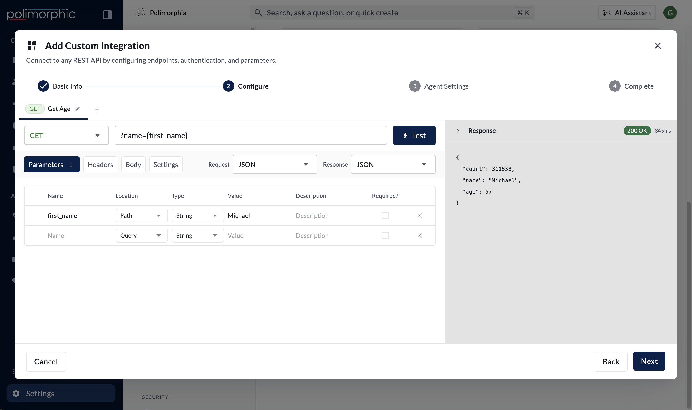
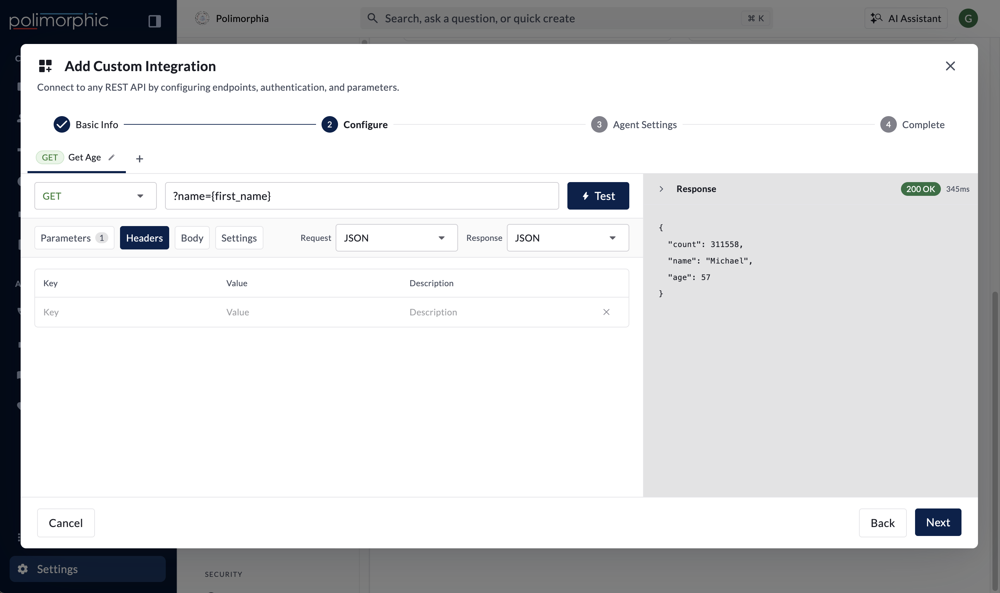
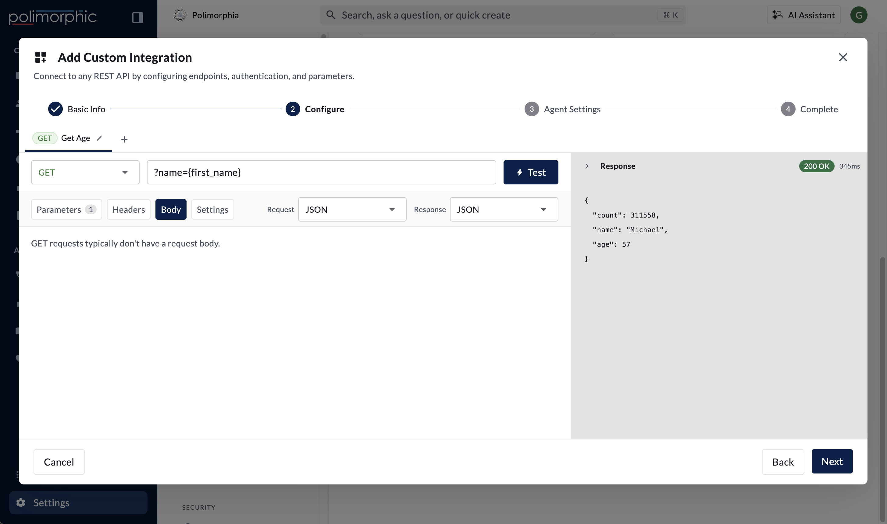
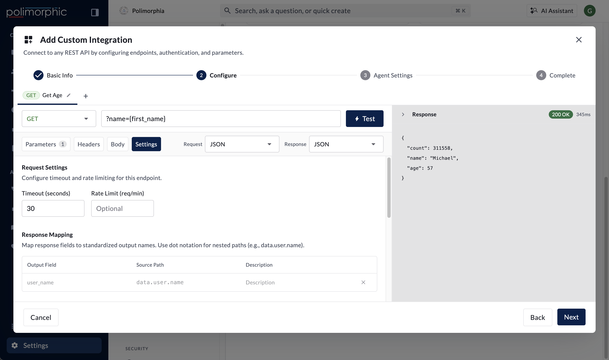
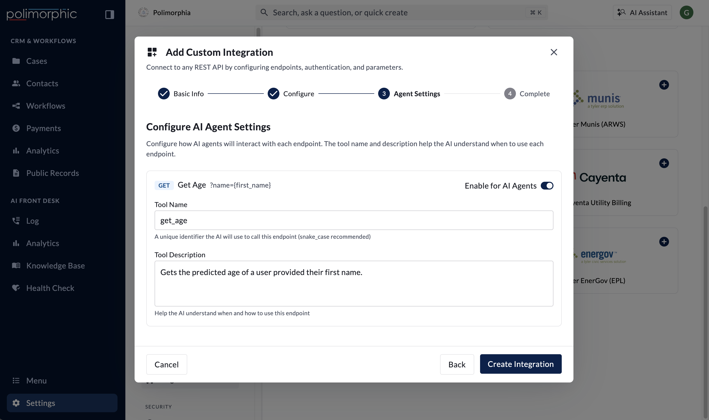
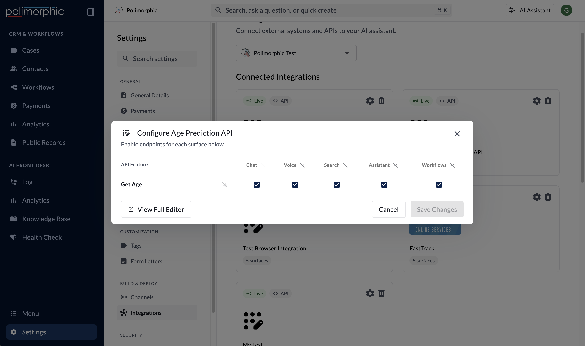

Not every system your organization uses is in the hosted catalog. If the provider offers an API, you can still connect it with a custom API integration and choose exactly what Polimorphic can do with it.

You need the provider's API documentation and safe test credentials. Use a non-production provider environment whenever possible.

Go to **Organization Settings > Build & Deploy > Integrations**, then select **Custom Integration**.

## Pick the integration type

Select **API**, the option labeled **Connect to web services**.

**Browser**, the option labeled **Extract data from web pages**, is a separate advanced option for systems that do not provide a suitable API. Browser integrations use page-navigation instructions and should not be treated as the default API setup method.

## 1. Complete Basic Info

Enter:

- **Integration Name:** A clear name staff will recognize.
- **Description:** Optional context about the system and intended use.
- **Base URL:** A complete URL beginning with `https://` or `http://`, such as `https://api.example.com`.
- **Authentication:** The method required by the provider.

Supported authentication choices are:

- **No Auth**
- **API Key:** Enter the header name and API key. Add a prefix only when the provider requires one.
- **Bearer Token**
- **Basic Auth:** Enter a username and password.
- **Query Parameter:** Enter the parameter name and value.
- **OAuth 2.0:** Enter the token URL, client ID, client secret, grant type, and any required scopes. The visible grant types are Client Credentials and Password. Password grant also uses a username and password.

### Default headers

Add headers that should be sent with every endpoint request, such as an API version or media type. Don't duplicate an authentication header already managed by the selected authentication method.

### IP proxy

Enable **Use IP Proxy** when the provider requires a fixed outbound address for allowlisting. Use the IP address displayed in the form when asking the provider to update its allowlist. Confirm the provider has applied the change before testing.

After creation, **Integration Type**, **Base URL**, and the **Auth Type** are read-only in the full editor. Confirm them before saving.

You can still replace the stored secret for the chosen auth type, such as an API key, bearer token, basic password, or client secret. Open the integration in the editor, enter the new value, test an endpoint, and save. Leave the field blank to keep the current value.

## 2. Add and configure endpoints

On **Configure**, select **Add Endpoint** and give the endpoint a clear name and description.

### Method and URL

Choose **GET**, **POST**, **PUT**, **PATCH**, or **DELETE**.

Enter an endpoint URL:

- Relative to the base URL, such as `/v1/accounts/{account_id}`
- A complete absolute URL when the endpoint uses a different host

Use `{name}` placeholders for path parameters.

### Parameters

Add each request value with its:

- Name
- Location: Query, Path, Header, or Body
- Type: String, Integer, Boolean, Number, Array, or Object
- Default value, when appropriate
- Description
- Required status

Use Path for every placeholder in the endpoint URL. Don't place secrets in ordinary parameter defaults.

### Headers

Add headers used only by this endpoint. Endpoint headers are combined with the connection's default headers.

### Body

  

For requests that send a body, choose the format required by the provider:

- **JSON:** Use the schema builder or raw JSON editor.
- **XML:** Use a SOAP 1.1, SOAP 1.2, or plain XML starting template, then adapt it to the provider's schema.
- **Form URL-Encoded:** Define the values expected by the provider.

Confirm required fields, nesting, content type, and provider-specific envelopes against the provider documentation.

### Settings

Configure:

- **Timeout:** From 1 to 300 seconds. The default is 30 seconds.
- **Rate Limit:** Optional requests-per-minute information for the endpoint.
- **Request Format** and **Response Format**
- **Response Mapping:** Map response paths to simpler output names using dot notation.
- **Validation Rules:** Define verified response requirements needed by this integration.
- **Identity Verification:** Require caller information to match values returned by the provider before personalized data is shared.
- **Endpoint Status:** Active or Disabled.

For identity verification:

1. Enable **Identity Verification**.
2. Add at least one unique field.
3. Enter the identity field name and the response path where the provider returns it.
4. Choose **Exact** or **Fuzzy (agent)** matching.
5. Test matches, mismatches, missing fields, and incomplete provider responses before enabling resident-facing access.

Exact matching ignores letter case and surrounding spaces. Fuzzy matching asks the verification agent to compare values cautiously.

## Test an endpoint before saving

Select **Test** in the endpoint editor.

The test sends a real request using the current connection and endpoint settings. Review:

- Success or failure
- HTTP status
- Response body
- Elapsed time
- Error details

Provide safe values for required path, query, header, and body parameters. Don't test a create, update, payment, or deletion request unless an approved sandbox and disposable test record are available.

A successful HTTP response does not by itself confirm response mapping, identity-verification behavior, end-user wording, or access in every Polimorphic surface. Complete those checks separately.

## 3. Configure Agent Settings

For each endpoint that an AI agent may use:

- Enable **Enable for AI Agents**.
- Enter a unique **Tool Name.**
- Write a **Tool Description** that states when the agent should use the capability, the information it needs, and important limits.

Keep tool descriptions specific. Don't instruct the agent to infer identifiers, credentials, or personal information.

## 4. Create the integration and configure access

Select **Create Integration** on the **Agent Settings** step, then find the connection under **Connected Integrations**. Open **Configure** to choose endpoint access for Chat, Voice, Search, Assistant, and Workflows.

Enable only the capabilities intended for each surface. See [Manage integration access across Polimorphic](/integrations/manage-integration-access-across-polimorphic).
