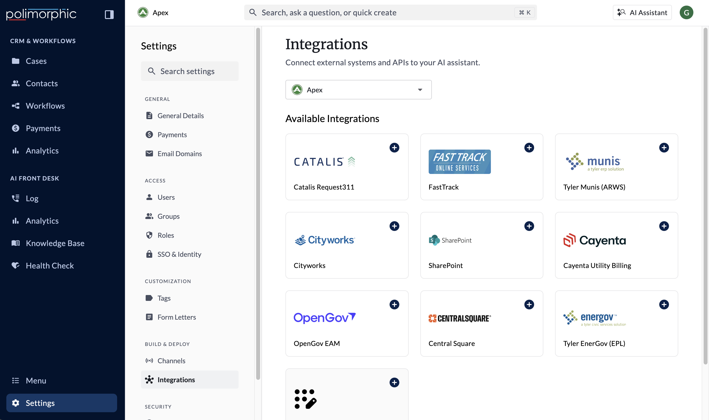
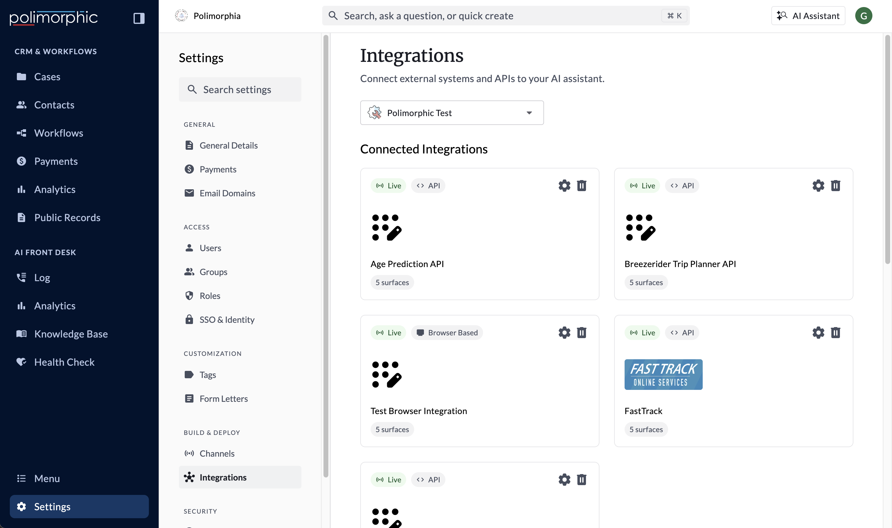

Your team already keeps permits, utility bills, and work orders in other systems. Integrations connect Poli to those systems so the AI and your staff can use that information without switching tools. Use a hosted integration for a supported product, or create a custom connection to an API that isn't in the hosted catalog.

## Before you begin

Integrations live in **Organization Settings > Build & Deploy > Integrations**.

Setup goes faster with this information on hand:

- The organization and test environment where the connection will be configured
- A dedicated service account or API credential with only the permissions the integration needs
- The provider host, base URL, or tenant information
- The authentication method and required credential values
- Any provider-side IP allowlist requirements
- The Poli surfaces that should be allowed to use each capability
- Safe test records or a provider sandbox, when available

Don't use resident information or production credentials while practicing setup or collecting screenshots.

## Pick hosted or custom

### Hosted integrations

Hosted integrations provide a guided setup for a supported product. Poli supplies the expected fields, capabilities, authentication behavior, and endpoint testing.

The hosted catalog currently includes:

- Catalis Request311
- FastTrack
- Tyler Munis (ARWS)
- Cityworks
- SharePoint
- Cayenta Utility Billing
- OpenGov EAM
- Tyler EnerGov (EPL)

A configured integration remains visible under **Connected Integrations**.

### Custom integrations

Use **Custom Integration** when the system you need isn't available as a hosted option. A custom API integration lets implementation staff define:

- The base URL and authentication method
- Default request headers
- One or more API endpoints
- Parameters, request bodies, and response formats
- Response mappings and validation
- Identity verification for personalized data
- AI-agent tool settings
- Access for Chat, Voice, Search, Assistant, and Workflows

Custom integrations require knowledge of the provider's API documentation. Ask the provider for a non-production environment and test credentials whenever possible.

## Handle credentials safely

- Use a dedicated integration account instead of a staff member's personal account.
- Grant only the provider permissions needed for the enabled capabilities.
- Enter credentials only in the Poli integration form.
- Don't send passwords, API keys, client secrets, or access tokens in tickets, chat messages, screenshots, or Loom recordings.
- Leave secret fields empty when documenting a setup flow.
- Rotate a credential if it may have been exposed.
- Confirm provider-side access and allowlists before treating a failed connection as a Poli issue.

Poli stores secret credential values separately from ordinary connection settings. Staff should still follow the organization's credential rotation and access-review practices.

## Choose where each integration is used

Open the connected integration and select **Configure** to review which capabilities are available to each Poli surface. Turn on only the capabilities each channel needs. Your choices take effect as soon as you save.

See:

- [Set up a hosted integration](/integrations/set-up-a-hosted-integration)
- [Create a custom API integration](/integrations/create-a-custom-api-integration)
- [Manage integration access across Poli](/integrations/manage-integration-access-across-polimorphic)
- [Test and troubleshoot an integration](/integrations/test-and-troubleshoot-an-integration)
