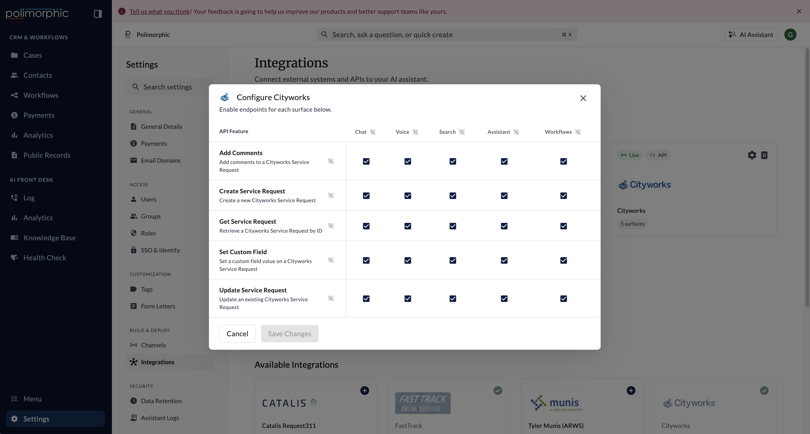

Once an integration is connected, you'll want to decide where it's used. You might let staff look up account details in the Assistant but keep that same lookup out of resident chat. Each connected integration can offer different capabilities to different Polimorphic surfaces, and you control which ones.

It's worth checking access after you create an integration and whenever the way your organization uses it changes.

## Change where a capability is used

Go to **Organization Settings > Build & Deploy > Integrations**. Under **Connected Integrations**, open the integration's **Configure** dialog.

## Understand the surface matrix

Rows represent API capabilities. Columns represent Polimorphic surfaces:

- **Chat:** Resident or staff chat experiences configured to use integration tools.
- **Voice:** Voice experiences configured to use integration tools.
- **Search:** Search experiences that may call an integration while answering a question.
- **Assistant:** The internal staff Assistant.
- **Workflows:** Workflow automation that uses an integration capability.

Select one cell to change one capability on one surface. Use the select-all control beside a capability to change all surfaces for that row. Use the select-all control beside a surface to change every listed capability in that column.

Select **Save Changes** when finished. The new access applies right away.

## Endpoint status and surface access are different

An endpoint has an overall active status and separate access settings for each surface.

- If at least one surface is enabled, the endpoint remains active.
- If all five surfaces are disabled, the endpoint becomes inactive.
- For a custom endpoint, **Enable for AI Agents** and valid tool settings are also needed before agent-driven surfaces can use it.
- A connected card marked live means at least one endpoint is active. It doesn't confirm that credentials are current, the provider is available, or every channel can use the endpoint.

The matrix is a configuration control. Test the capability in every enabled surface, especially an existing Workflow that already references an integration endpoint.

## Turn on only what each channel needs

Give each channel only the capabilities it needs.

Examples:

- Keep write operations off resident-facing Chat and Voice unless the use case and confirmation flow have been approved.
- Limit staff-only document access to Assistant.
- Keep identity-protected account data off surfaces that don't collect the required verification information.
- Disable unused endpoints instead of leaving them available for possible future use.

**SharePoint access**

SharePoint delegated access is intended for the internal Assistant. Each user connects a Microsoft account, and Microsoft applies that user's SharePoint permissions. Don't treat generic surface checkboxes as confirmation that delegated SharePoint is available in resident Chat, Voice, Search, or Workflows.

Shared SharePoint access uses one service identity. Everyone using that connection receives content available to that identity, so review the service identity's Microsoft permissions carefully.
