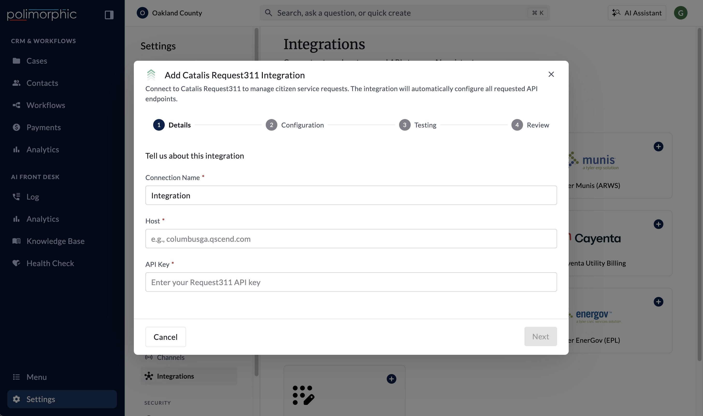
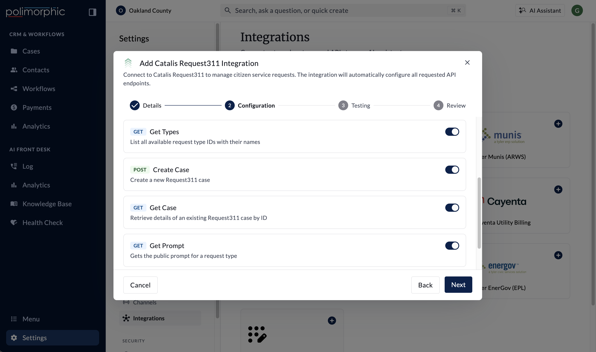
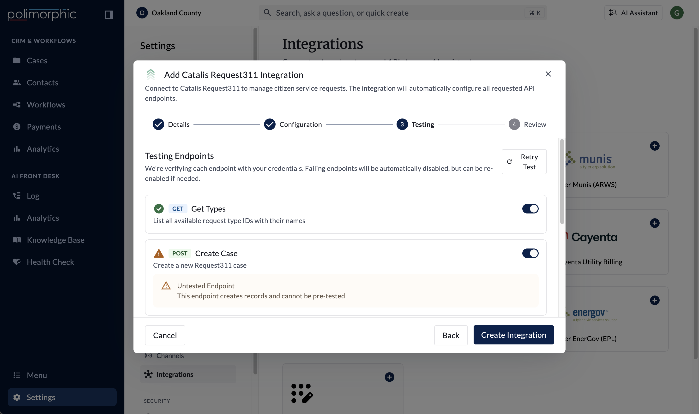
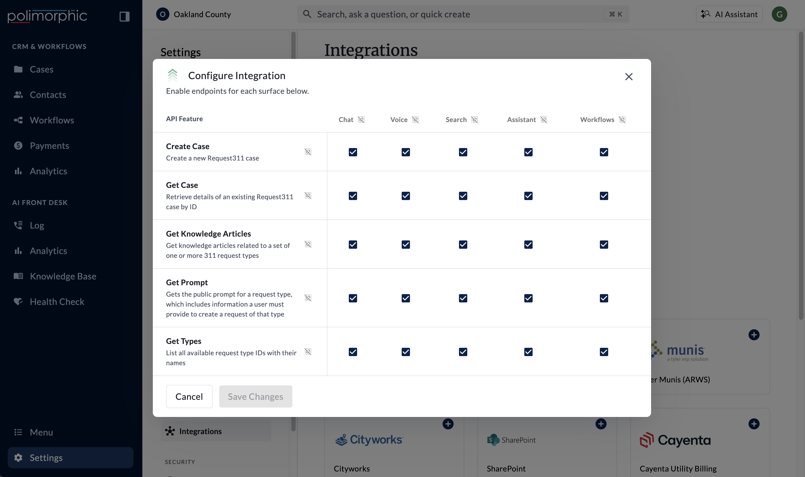

If your organization uses one of the supported products, such as Cityworks or Tyler Munis, you don't need to build anything yourself. A hosted integration walks you through a guided setup in three steps: **Details**, **Configuration**, and **Testing**.

Go to **Organization Settings > Build & Deploy > Integrations**, find the product under **Available Integrations**, and select its card.

## 1. Enter connection details

On **Details**:

1. Confirm or change the **Connection Name**.
2. Enter the provider host, URL, tenant information, or credentials requested for that product.
3. Use a dedicated service account or API credential.
4. Select **Next**.

Use the format shown in the product-specific guide. Some fields require a host without `https://`, while other fields require a complete URL.

If the form shows a connection name or values from a different provider you opened earlier, select **Cancel** and reload the Integrations page before continuing.

## 2. Pick what the integration can do

On **Configuration**:

1. Review the listed API capabilities.
2. Turn off any capability your organization doesn't plan to use.
3. Complete any product-specific choices, such as required submitter fields or an access mode.
4. Select **Next**.

A capability turned off here isn't meant to be available to the AI agent. After setup, use the connected integration's **Configure** dialog to confirm capability access for each Polimorphic surface.

## 3. Check the test results

The **Testing** step starts automatically. Polimorphic safely tests capabilities when the check can be completed without creating or changing provider data.

Each tested capability can show one of these results:

- **Successful:** Polimorphic reached the provider and received an acceptable response.
- **Failed:** The testable capability returned an authentication, permission, connection, timeout, or response error. Polimorphic switches a failed testable capability off in the setup screen.
- **Untested Endpoint:** The check needs a real record identifier, personal verification data, or a request that would create or change provider data. An untested result isn't a credential failure.

Select **Show error** when available to view technical details. Select **Retry Test** after correcting the host, credentials, permissions, allowlist, or provider configuration.

You can turn a failed capability back on, but complete an end-user test before making it available. For FastTrack and SharePoint, confirm the final enabled state again in the connected integration's **Configure** dialog.

## 4. Create the integration

Select **Create Integration** after reviewing the test results. This creates the connection and closes the setup window. The new connection appears under **Connected Integrations** on the Integrations page.

Creating the connection doesn't replace an end-user test. Test each newly connected capability through Chat, Voice, or Assistant before staff or residents rely on it.

## Choose where the integration is used

Under **Connected Integrations**, open **Configure** for the new connection.

Review each capability across:

- Chat
- Voice
- Search
- Assistant
- Workflows

Select **Save Changes** after updating access, and the new access applies right away. See [Manage integration access across Polimorphic](/integrations/manage-integration-access-across-polimorphic) for guidance.
