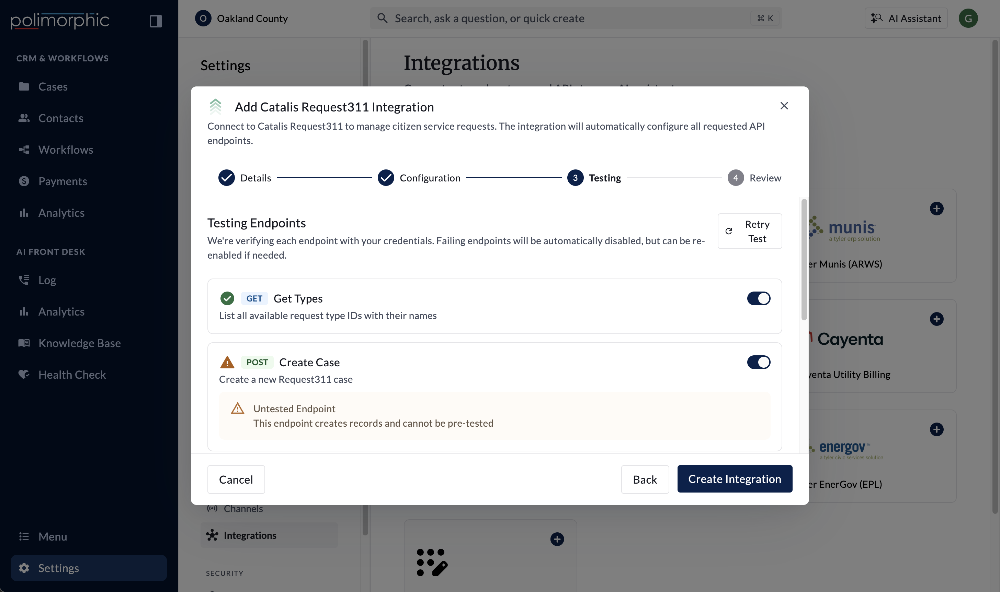
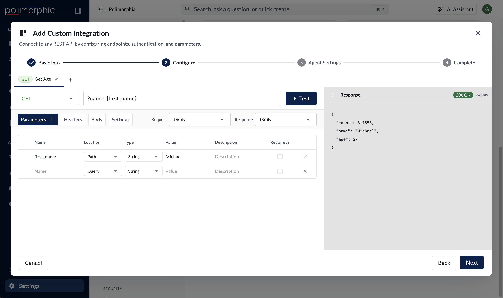

An integration that looks connected can still fail when a resident actually uses it. Test it during setup, then again from every Poli surface where its capabilities are turned on, so you catch problems before residents or staff do.

Never use real resident information, production changes, or unapproved provider records for troubleshooting.

## Check the connection information

Before changing endpoint settings, confirm:

- The host or base URL matches the format in the integration-specific guide.
- The provider environment is reachable over HTTPS.
- The API key, password, token, or client secret is current.
- The account has permission for the requested operation and data.
- The provider has enabled the required API.
- Any provider IP allowlist includes the address shown in Poli.
- The organization and connected integration are the intended test targets.

## Understand hosted endpoint results

On the hosted **Testing** step:

- A successful result means the safe setup check received an acceptable response.
- A failed testable result is switched off in the setup screen. Correct the issue, then select **Retry Test**.
- **Untested Endpoint** means the operation needs real IDs, personal verification values, or a request that would create or change data. It is not proof of a credential problem.

Some hosted checks validate only a prerequisite:

- Catalis Request311 starts with request types.
- FastTrack starts with a built-in permit search.
- Tyler Munis (ARWS) tests bank codes.
- Cityworks tests sign-in.
- SharePoint tests Microsoft token acquisition and, in shared mode, search.
- Cayenta tests location search.
- OpenGov EAM tests listing work orders.
- Tyler EnerGov (EPL) tests sign-in and quick search.

Complete a separate end-user test for operations that need a real record or identity check.

## Test a custom endpoint

In the custom integration editor:

1. Select the endpoint.
2. Enter synthetic or sandbox values for required parameters.
3. Select **Test**.
4. Review the HTTP status, response, elapsed time, and error.
5. Correct the configuration and test again before saving.

## Fix common problems

### URL and host

- Use a complete `https://` base URL for a custom API.
- Use the exact hosted format in the product-specific guide.
- Remove accidental paths, duplicated schemes, spaces, or trailing text.
- Confirm every `{path_parameter}` has a Path parameter value.
- Check DNS and network reachability.

### Authentication

- **HTTP 401:** Recheck the API key, username and password, bearer token, query credential, or OAuth client values. To replace an expired secret on a custom integration, open it in the editor, enter the new value, test the endpoint, and save.
- **HTTP 403:** Confirm the account can access the resource or operation.
- **OAuth 2.0:** Confirm the grant type, token URL, client ID, client secret, username and password when required, and scopes.
- **Delegated SharePoint:** Each user must connect Microsoft before the Assistant can search as that user.
- Rotate and replace expired or revoked credentials.

### Parameters and request body

- Match parameter names and capitalization to the provider documentation.
- Put values in the correct Query, Path, Header, or Body location.
- Confirm required values are present.
- For JSON, verify nesting and data types.
- For XML or SOAP, verify the envelope, namespaces, element names, and content type.
- For form-encoded requests, verify the provider expects form data instead of JSON.

### Response format and mapping

- Confirm the selected response format matches the provider response.
- Verify each response-mapping path exists in a successful sample.
- Test empty lists, missing optional values, and provider error bodies.
- Confirm identity-verification response paths are present when protected data is returned.

### Timeout and rate limits

- Increase the endpoint timeout only after confirming the provider is responding slowly.
- Keep the timeout between 1 and 300 seconds.
- Check provider throttling or rate-limit responses.
- Avoid repeated retries that may worsen throttling.

### Permissions and allowlists

- Confirm the provider account can perform each enabled capability.
- Ask the provider to verify its IP allowlist and firewall logs.
- Use the fixed outbound address displayed in Polimorphic when IP proxying is enabled.
- Check whether the provider restricts access by environment, tenant, site, department, or record type.

## Test each enabled Polimorphic surface

For Chat, Voice, Search, Assistant, and Workflows:

1. Use a safe question or test record.
2. Confirm the correct capability is selected.
3. Confirm required identity information is requested before protected data is returned.
4. Confirm write operations require the intended confirmation or workflow conditions.
5. Confirm disabled capabilities are not offered.
6. Review the provider result for correctness, not only a successful status.

## Get help from support

Include:

- Organization and environment
- Integration name and capability
- Polimorphic surface
- Time of the test and time zone
- HTTP status and sanitized error message
- Whether the issue affects all users or one user
- Whether the same credentials work directly with the provider
- Steps already attempted

Never include a password, API key, client secret, access token, session cookie, SSN, or resident information.
