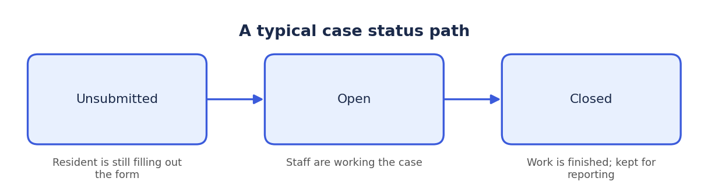

A single permit renewal can involve a form, an uploaded inspection report, a fee, three emails, a phone call, and two staff reviewers. A [case](/getting-started/glossary) keeps all of that in one place, from the first request to the last step. Anyone on your team can pick it up and see what happened and what comes next, without digging through inboxes or asking a coworker for the history.

That means residents get faster, more consistent answers, and your department has a clear record for audits and reports.

### Where cases come from

- A resident fills out an online form on your website.
- A resident starts a request after asking the [AI Front Desk](/getting-started/glossary) a question.
- A staff member opens a case by hand, such as after a phone call or a visit to the counter.

### What's on a case

Every case page has a header and a set of tabs.

- **Header:** the case name, its status, its tags, and buttons such as **Send email**, **Manage access**, and **Share case**. Cards show the **Case Requester** (who the case is for), the **Case Manager** (the staff owner), and how long the case has been open.
- **Tasks:** the steps and tasks that need attention now. Switch between **My work** and **All**.
- **Workflow** tab: every step of the [workflow](/getting-started/glossary) and whether it's done, active, or waiting.
- **Details** tab: the answers from each completed form, field by field.
- **Activity** tab: the full history of the case, newest or oldest first.
- **Documents** tab: files residents uploaded, files Polimorphic generated, and other files.
- **Members** tab: the people on the case, such as the requester and anyone invited to it.

If a case doesn't follow a workflow, it has no **Workflow** tab, and the **Details** tab is called **Related Cases**.

### Filter the Activity tab

You can filter the **Activity** tab by entry type:

| Filter | What it shows |
| --- | --- |
| **Notes** | Internal notes from staff. Residents never see these. |
| **Emails** | Emails sent from the case, replies from residents, and emails forwarded to the case's email address. |
| **Calls** | Phone calls staff logged, and calls handled by the AI phone line. |
| **Submissions** | Each time someone submits a form, including resubmissions. |
| **Payments** | Payments taken, recorded, waived, or changed. |
| **Documents** | Files added or generated. |
| **System** | Changes Polimorphic or staff made to the case, such as status changes, assignments, tags, due dates, and automatic emails. |

### How a case moves

Most cases start as **Unsubmitted** while the resident fills out the form. The workflow usually changes the case to **Open** when staff work begins. When the work is done, the case becomes **Closed**, either from a workflow step or because a staff member changed the status. Closed cases stay in your records and reports.

## Example: a building permit renewal

A homeowner applies to renew a building permit on your website. Polimorphic creates a case named for the renewal and links it to the homeowner's [contact](/getting-started/glossary). The workflow assigns the case to the permit desk, and the case shows **Your Turn** for the permit technician on duty. The technician opens the **Details** tab to read the application, finds that the inspection report is missing, and emails the homeowner from the case. The homeowner's reply appears on the **Activity** tab with the uploaded report, which also appears on the **Documents** tab. After the fee is paid, the workflow closes the case and sends the renewed permit.

## Related articles

- [Find and triage a case](/working-in-polimorphic/cases/find-and-triage-a-case)
- [Create and assign a case](/working-in-polimorphic/cases/create-and-assign-a-case)
- [Communicate with a resident from a case](/working-in-polimorphic/cases/communicate-with-a-resident-from-a-case)
- [Case statuses and the document center](/working-in-polimorphic/cases/case-statuses-and-the-document-center)
