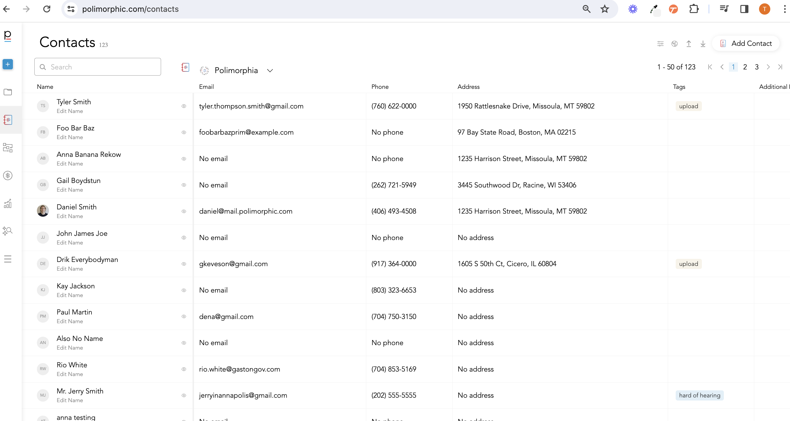
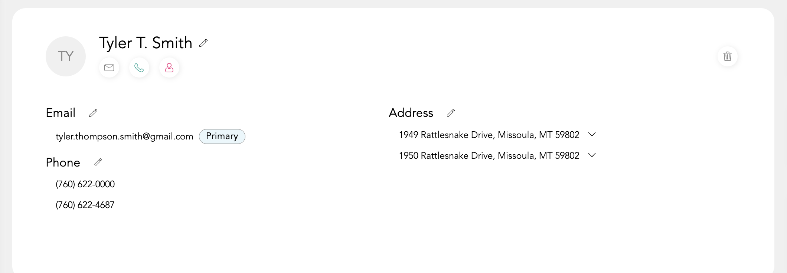

When a resident moves, gets a new phone number, or changes their email, you can update their contact so future cases and messages reach them. You can update one contact yourself, or have us update many at once.

## Update a single contact

1. Go to **Contacts** in the left-hand sidebar.

2. Search for the contact and click their name to open it.

3. Click the pencil icon next to the information you'd like to change, then add or remove details.

The contact shows the new details right away.

## Update many contacts at once

Bulk updates are done with a contacts upload. Contact your Customer Success Manager or [support@polimorphic.com](mailto:support@polimorphic.com) and we'll take care of it for you.
