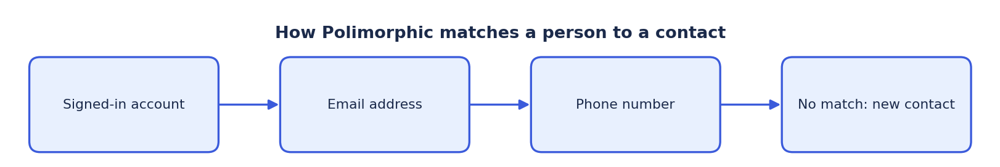

A resident who calls about a permit may also have an open code complaint and an unpaid utility bill. When you can see all of that at once, you can help them fully on the first call, without asking for information they've already given you.

That's what a [contact](/getting-started/glossary) is for. It's the record for one person or organization your team works with, and Polimorphic links it to their [cases](/getting-started/glossary), calls, and messages so their full history is in one place.

### How Polimorphic matches people to contacts

When a resident submits a form, calls, or replies to a message, Polimorphic looks for their contact in this order:

1. A matching signed-in resident account.
2. A matching email address. Capital letters don't matter, so *Maria.Lopez@example.com* and *maria.lopez@example.com* match.
3. A matching phone number. Polimorphic compares numbers in a standard format, so different spacing or dashes still match.

If nothing matches, Polimorphic can create a new contact. That's why the same person can end up with two contacts if they use a different email address and phone number each time.

### Your contact book

All of your organization's contacts live in its [contact book](/getting-started/glossary). A contact can be an **Individual** or an **Organization**, such as a contractor or a business. You can connect contacts to each other with **Related Contacts**, such as a property owner and their property manager.

### What a contact page shows

- **Contact Details:** email addresses, phone numbers, addresses, date of birth, tags, and any additional data your team tracks.
- **Activity:** the contact's history, newest first. It includes their cases, AI phone call logs, [outbound communications](/getting-started/glossary) sent to them, and their replies. Select a case to open it.
- **Related Contacts:** people and organizations connected to this contact.
- **Notes:** internal notes about the contact.

### What deleting a contact does

Deleting a contact removes it from your contact book. It doesn't delete the communications, logged calls, or logged visits connected to it.

## Example: one resident, three conversations

James Carter owns a rental property. In March he applies for a rental inspection on your website with *jcarter@example.com*. Polimorphic creates a contact for him. In June he calls your AI phone line from the number on his application to ask about trash pickup. Polimorphic matches the phone number, so the call log appears on the same contact. When a code enforcement officer opens James's contact in July, she sees the inspection case, the call, and the reminder email your office sent him, all in one list.

## Related articles

- [Add or edit a contact](/working-in-polimorphic/contacts/add-or-edit-a-contact)
- [Import contacts from a file](/working-in-polimorphic/contacts/import-contacts-from-a-file)
- [Contact fields](/working-in-polimorphic/contacts/contact-fields)
